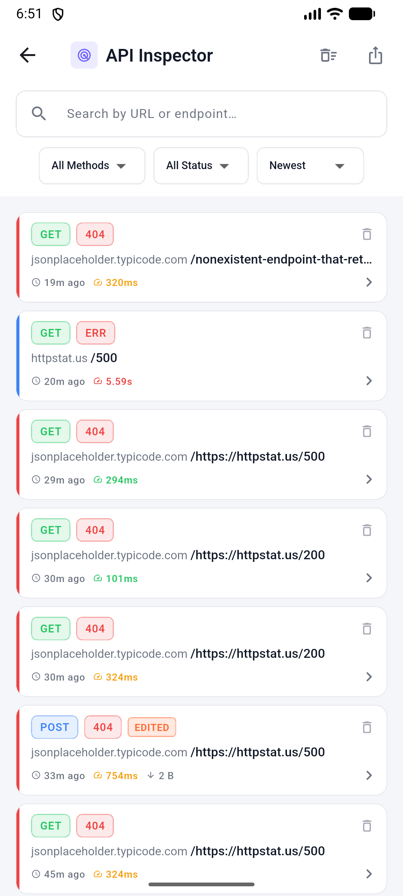
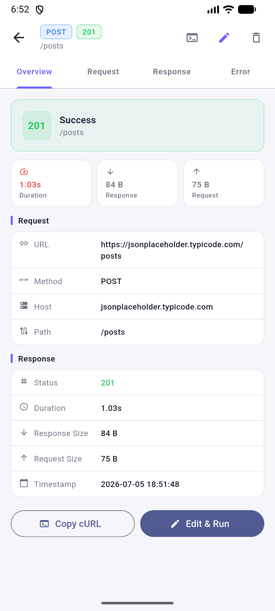
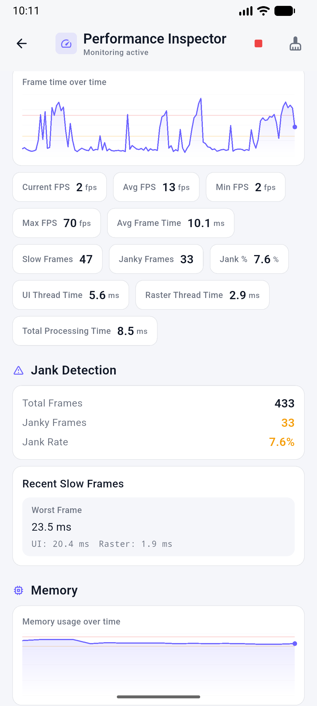
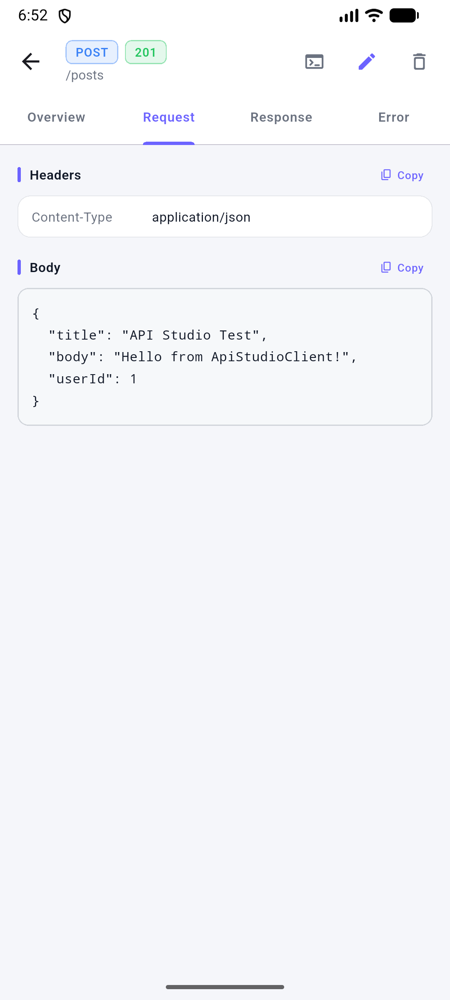
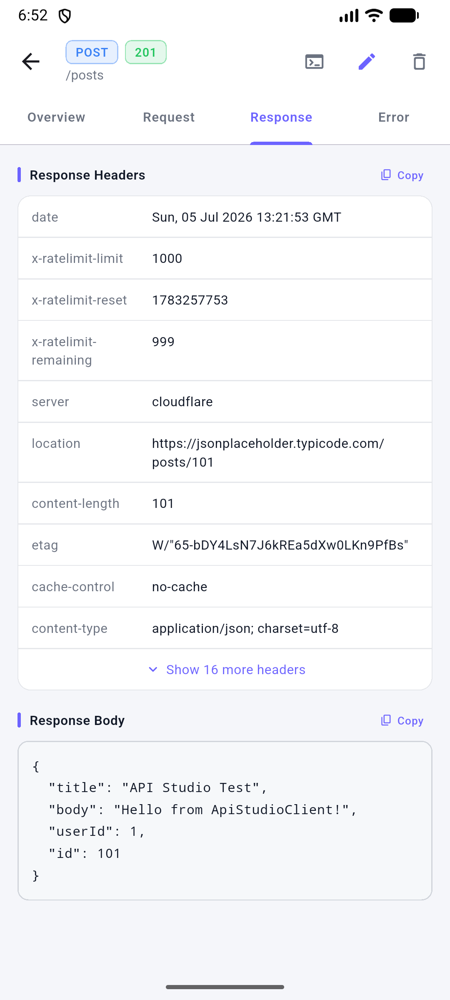
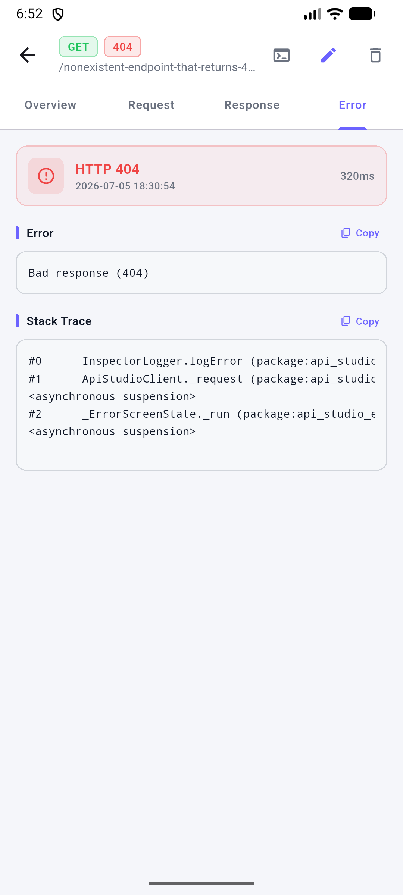
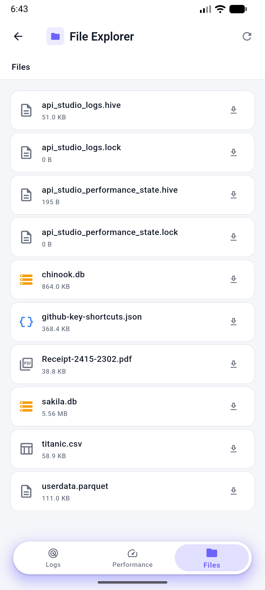

[](https://pub.dev/packages/api_studio)
[](https://github.com/princesaini-dev/api_studio/actions/workflows/ci.yml)
[](LICENSE)

<h1 align="center">API Studio</h1>

<p align="center">
  An in-app network inspector for Flutter, with an optional cloud dashboard so QA and developers can look at the same requests.
</p>

## ⏱️ 30-second quick start

```dart
await ApiStudio.initialize();
dio.interceptors.add(ApiStudioDioInterceptor());
// anywhere:
ApiStudio.showNavigation(context);
```

That's it. Every Dio request now appears in the inspector, with secrets redacted. In release builds API Studio is off by default and costs nothing.

### Install

```yaml
dependencies:
  api_studio: ^1.1.0
  api_studio_dio: ^1.0.0    # if you use Dio
  # api_studio_http: ^1.0.0 # if you use package:http
```

```dart
import 'package:api_studio/api_studio.dart';
import 'package:api_studio_dio/api_studio_dio.dart';

Future<void> main() async {
  WidgetsFlutterBinding.ensureInitialized();
  await ApiStudio.initialize();
  runApp(const MyApp());
}
```

Using `package:http`? Wrap your client instead:

```dart
final client = ApiStudioHttpClient(inner: http.Client());
```

Using something else (Chopper, GraphQL, gRPC-web, a custom client)? Call [`ApiStudio.log`](#any-other-client-apistudiolog) from wherever you see the response.

> **Why separate packages?** Dart has no optional dependencies. Shipping the Dio interceptor inside `api_studio` would force `dio` on every app. With companion packages, you only pull in the client you actually use.

---

## ✅ Features

| Feature | |
|---|:---:|
| Automatic capture for **Dio** (`api_studio_dio`) and **package:http** (`api_studio_http`) | ✅ |
| Universal `ApiStudio.log(...)` for any other client | ✅ |
| Request/response headers, body, query, status, timing, errors and stack traces | ✅ |
| Multipart, binary, oversized (truncated), cancelled and timed-out requests | ✅ |
| **Redaction** of headers, JSON keys and query params before storage, upload and export | ✅ |
| Search, filter by method/status, sort | ✅ |
| **Edit & Run**: modify and replay any captured request | ✅ |
| Copy as **cURL** | ✅ |
| Export as **JSON**, **TXT**, **HAR 1.2** and **Postman Collection v2.1** | ✅ |
| Floating debug button, and opening without a `BuildContext` | ✅ |
| Performance Inspector: FPS, jank, frame times, memory, startup | ✅ |
| Read-only File Explorer for the app sandbox | ✅ |
| Optional cloud dashboard: [apistudio.cloud](https://apistudio.cloud/) | ✅ |
| Connectivity and failed-API streams, Slack/callback alerts on failures | ✅ |
| Release-safe: no-op by default outside debug builds | ✅ |

<p align="center">
  
  
  
</p>
<p align="center"><sub>API Inspector list · Request detail · Performance Inspector</sub></p>

### Opening API Studio

```dart
ApiStudio.showNavigation(context);           // Logs + Performance + Files
ApiStudio.show(context);                     // Logs only
ApiStudio.showPerformanceInspector(context);
ApiStudio.showFileExplorer(context);

// Without a BuildContext:
MaterialApp(navigatorKey: ApiStudio.navigatorKey, ...);
ApiStudio.open();

// Draggable floating button (e.g. from initState, after the first frame):
WidgetsBinding.instance.addPostFrameCallback(
  (_) => ApiStudio.showFloatingButton(context),
);
```

Want shake-to-open? API Studio deliberately doesn't depend on a sensors plugin. Wire your favorite shake detector to `ApiStudio.open()`.

### Inspector, Edit & Run, cURL

<p align="center">
  
  
  
</p>

- Every captured request can be copied as a POSIX-safe cURL command.
- **Edit & Run** lets you change the method, URL, headers, query or body and send the request again, including requests captured from Dio and http. Values that were redacted before storage are flagged, so you can re-enter them first. Multipart files and truncated bodies are flagged too.

### � Export logs

From the inspector's share menu: **JSON**, **TXT**, **HAR** (open in Chrome DevTools, Charles, Proxyman, Insomnia…) or **Postman collection**. Exports always re-apply your redaction rules.

### ⚡ Performance Inspector

Opt-in, on-device performance monitoring: current/average/min/max FPS, frame time, janky frames and jank rate, UI and raster thread time, memory (where available), startup phases, per-screen tracking, a timeline and an overall health score. Histories are bounded, so memory can't grow without limit.

```dart
await ApiStudio.initialize(enablePerformanceMonitoring: true);
// or toggle at runtime:
ApiStudio.startPerformanceMonitoring();
ApiStudio.stopPerformanceMonitoring();
```

### 📁 File Explorer

A read-only browser for your app's sandbox: breadcrumbs, open with the OS handler, and download/share.

> ⚠️ **Do not ship the File Explorer to end users.** It can list and share private files (databases, caches, persisted tokens). It only works while API Studio is enabled, which defaults to debug builds only.

<p align="center"></p>

---

## 🤔 Why API Studio?

- **Proxy tools** (Charles, Proxyman, mitmproxy) need proxy and certificate setup on every device, and struggle with certificate pinning.
- **Flutter DevTools' network tab** needs a debugger attached to the app.
- **Other in-app inspectors** show traffic on the device only.

API Studio gives you an **in-app inspector** that works on any build you choose to enable, plus an optional **shared cloud dashboard**. A QA engineer reproduces a bug, and the developer sees the exact (redacted) requests on [apistudio.cloud](https://apistudio.cloud/) without needing the device or a screen recording.

---

## ☁️ Cloud dashboard (optional)

Pass an API key from [apistudio.cloud](https://apistudio.cloud/) to forward captured logs to your team's dashboard:

```dart
await ApiStudio.initialize(apiKey: 'YOUR_API_KEY');
await ApiStudio.flush(); // optional: push pending logs immediately
```

- Off unless you pass an `apiKey`.
- Uploads only already-redacted logs. Fire-and-forget: it never blocks, delays or throws into your app.
- Debounced near-real-time sync (immediate on errors), with auto-flush when the app is backgrounded.
- Requests to the API Studio backend itself are never captured.
- Optional aggregated performance telemetry (`enablePerformanceMonitoring: true`), uploaded at most once per interval.

---

## 🔒 Privacy and data

**What is collected:** for each captured request, the URL, method, request/response headers, query parameters, bodies (multipart files are described, never stored; binary bodies become a size placeholder), status code, duration, error message and stack trace.

**Where it goes:**

| Destination | When |
|---|---|
| Local storage on the device (`hive_ce`, unencrypted, `<app documents>/api_studio`) | Whenever API Studio is enabled |
| [apistudio.cloud](https://apistudio.cloud/) | Only if you pass `apiKey` |
| Slack / your callback | Only if you configure `notificationConfig`, and only for failed requests |

**What is redacted** before local storage, before upload, and in cURL and every export:

- **Headers** (case-insensitive): `Authorization`, `Cookie`, `Set-Cookie`, `X-API-Key`, `Proxy-Authorization`.
- **JSON body keys, form fields and query parameters**, matched recursively and case-insensitively, ignoring `_`/`-`: `password`, `token`, `access_token`, `refresh_token`, `secret`, `api_key`, `authorization`, `card_number`, `cvv`.
- Values become `***REDACTED***`. Add your own keys or a custom hook:

```dart
await ApiStudio.initialize(
  redaction: RedactionConfig(
    redactHeaders: ['X-Session-Id'],
    redactBodyKeys: ['ssn', 'pin'],
    redactor: (log) => log.copyWith(
      url: log.url.replaceAll(RegExp(r'/users/\d+'), '/users/:id'),
    ),
  ),
);
```

Redaction is key-based. Secrets inside free-form text, URL path segments or error messages are not detected; use the `redactor` hook for those.

**How long it is kept:** 500 logs or 7 days by default, whichever comes first, with bodies capped at 1 MB each and ~50 MB in total.

**How to disable:**

- Remote logging: omit `apiKey`.
- Everything: `ApiStudio.initialize(enabled: false)`. This is already the default in release builds. When disabled there is no storage, no timers, no frame callbacks, no network and no UI, and the interceptors pass requests straight through.

See [SECURITY.md](SECURITY.md) for the full threat model.

---

## ⚙️ Advanced configuration

```dart
await ApiStudio.initialize(
  enabled: kDebugMode,              // master switch (default). Use `true` for QA builds.
  apiKey: null,                     // apistudio.cloud key; null = no upload
  redaction: const RedactionConfig(),
  maxStoredLogs: 500,
  logRetention: const Duration(days: 7),
  maxBodyBytes: 1024 * 1024,
  navigatorKey: myNavigatorKey,     // for ApiStudio.open() / floating button
  theme: const ApiInspectorThemeData(),
  enablePerformanceMonitoring: false,
  enableConnectivityStream: false,
  enableFailedApiStream: false,
  notificationConfig: NotificationConfig(
    slackWebhook: 'https://hooks.slack.com/…',
    onApiFailed: (log) => debugPrint('API failed: ${log.url}'),
  ),
  // Optional built-in client (see below):
  enableApiClient: true,
  baseUrl: 'https://api.example.com',
);
```

Calling `initialize` again is safe: the latest values apply.

### Any other client: `ApiStudio.log`

```dart
await ApiStudio.log(
  url: 'https://api.example.com/users',
  method: 'GET',
  statusCode: 200,
  durationMs: 145,
  requestHeaders: {'Accept': 'application/json'},
  responseBody: response.body,   // String, Map/List, or List<int> bytes
);
```

It goes through the same pipeline as the interceptors (redaction → truncation → storage → upload). It's a no-op when disabled and never throws.

### Built-in `ApiStudioClient` (optional, useful for manual testing)

If you just want a quick client that is already wired into the inspector, without adding Dio or http, API Studio includes one. It supports retries, caching, cookies, multipart uploads, downloads and duplicate-request strategies.

```dart
await ApiStudio.initialize(baseUrl: 'https://api.example.com'); // enableApiClient defaults to true
final res = await ApiStudioClient.instance.get<Map<String, dynamic>>('/posts/1');
```

Pass `enableApiClient: false` if you don't use it; nothing client-related is then created. If you rely on `ApiStudioClient` for real traffic, it keeps working when API Studio is disabled; its requests just aren't logged.

### Connectivity and failed-API streams

```dart
await ApiStudio.initialize(enableConnectivityStream: true, enableFailedApiStream: true);
ApiStudio.internetConnectivityStream.listen((online) { /* … */ });
ApiStudio.failedApiCountStream.listen((count) { /* update a badge */ });
final online = await ApiStudio.isInternetConnected(); // always available
```

### Name clashes

`package:api_studio` exports the built-in client's types, including `CancelToken`, `ProgressCallback` and `TimeoutException`. If a file also imports Dio or `dart:async`'s `TimeoutException`, hide the ones you don't need:

```dart
import 'package:api_studio/api_studio.dart' hide CancelToken, ProgressCallback, TimeoutException;
```

---

## ⬆️ Migrating from 1.0.x

- **Release builds are now off by default.** If you used API Studio in release/QA builds, pass `enabled: true`.
- **Replace manual `ApiStudio.log` calls in Dio interceptors** with `ApiStudioDioInterceptor` from `api_studio_dio`.
- `ApiStudio.init(...)` is deprecated: use `ApiStudio.initialize(...)`.
- Existing logs are migrated automatically (`hive` → `hive_ce`) and re-redacted on first launch. Unreadable data is cleared instead of crashing.
- The default `maxStoredLogs` is now 500 (was 10,000).

See the [CHANGELOG](CHANGELOG.md) for details.

## 📄 License

MIT
